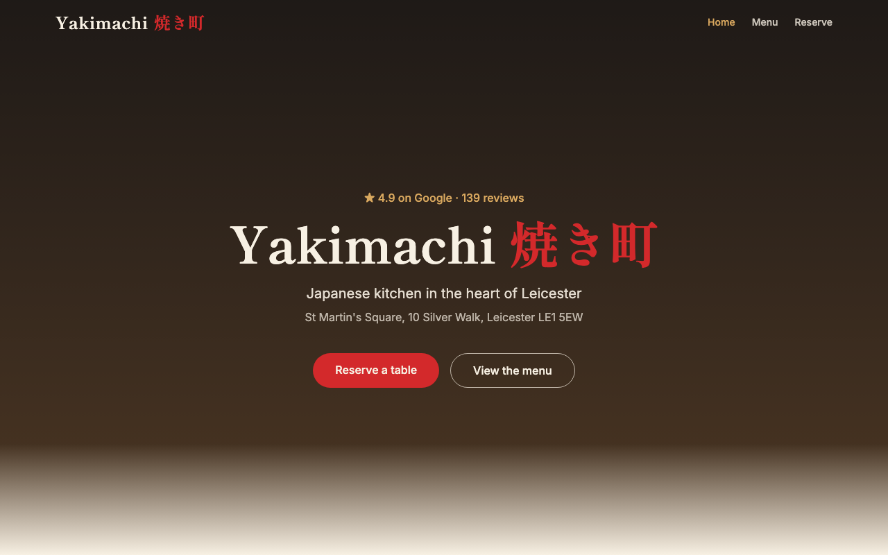
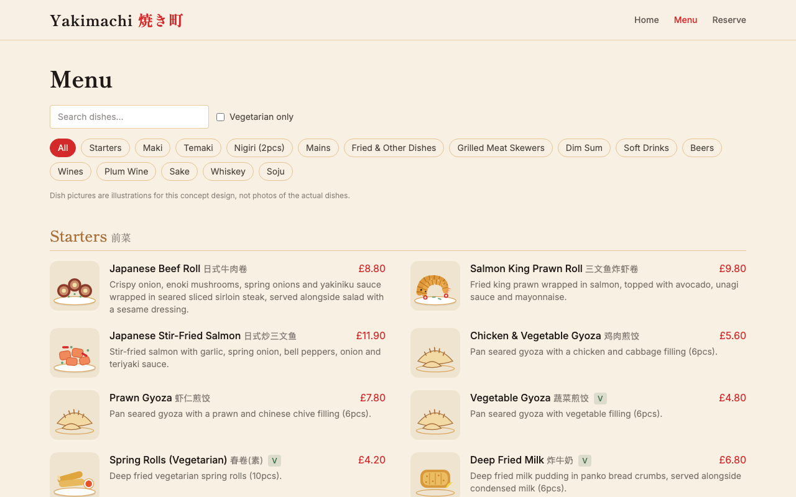
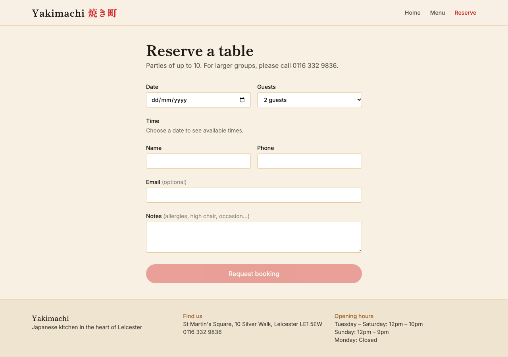
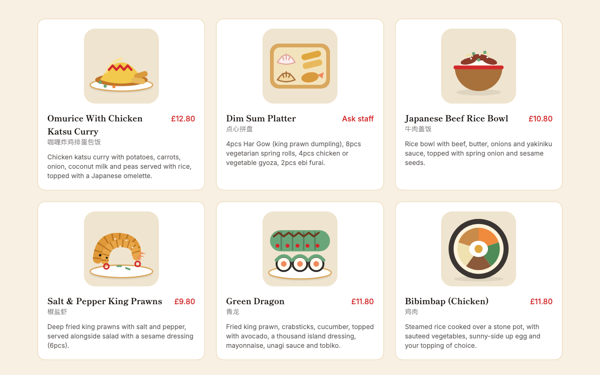
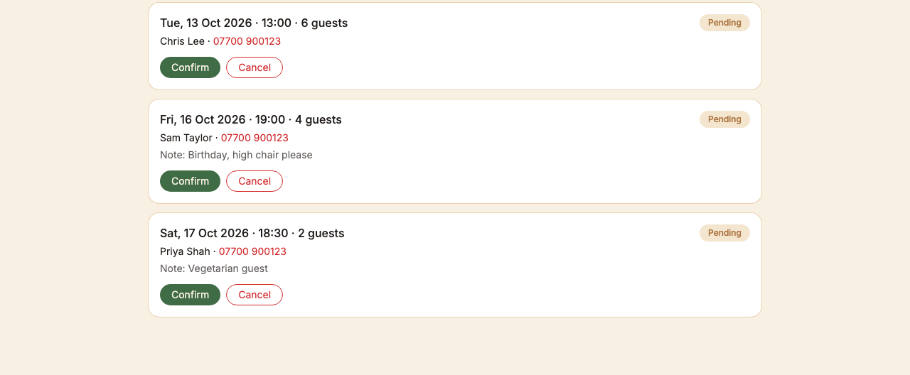
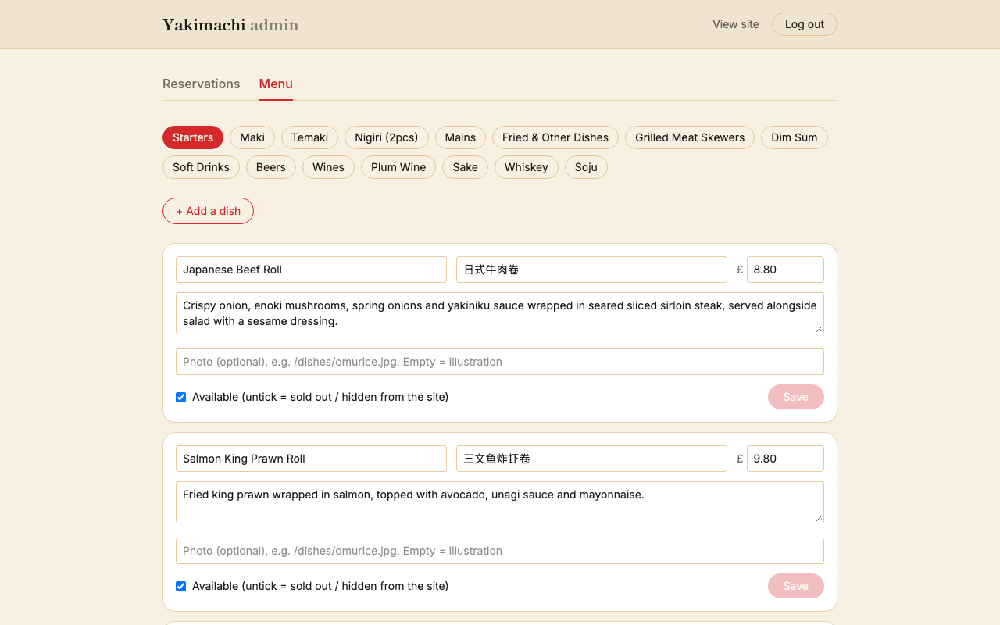

# Yakimachi: restaurant website with reservations and admin dashboard

A full-stack concept website for a Japanese restaurant: customers browse the menu and request a table, and the owner manages bookings and the menu from a password-protected dashboard.

> **This is a concept/demo project.** It is a design exercise based on a real local restaurant's public Google listing. It is **not** the restaurant's official website, and the restaurant is not affiliated with it. The restaurant's name, address, phone number, opening hours, menu text and review quotes come from public listings. The dish pictures are my own SVG illustrations, not photos of the real dishes. The restaurant's own photo is deliberately **not** included in this repository. If you represent the restaurant and want anything changed or removed, please open an issue.



> **Full documentation is in [`docs/`](docs/README.md):** getting started, architecture, API reference, configuration, booking rules, admin guide, email setup, security notes and roadmap.

## Features

**Customer site**
- Home page with customer favourites (loaded live from the API), Google review quotes, opening hours and a directions link
- Menu with 95 items in 15 categories: search, category tabs, vegetarian filter, Chinese + English names, and "Ask staff" for items with no listed price
- Table reservations: pick a date and party size, see only the time slots that are actually free, and get clear validation errors
- Responsive layout, checked at phone width

**Owner dashboard (`/admin`)**
- Login with a signed token (JWT) and a lockout after repeated wrong passwords
- Reservations: filter by status, confirm, cancel (with a confirm prompt) or restore bookings. Customers who left an email get a confirmation or cancellation email automatically
- Menu editor: change names, prices and descriptions, mark dishes sold out (hidden from the public menu), add new dishes, and attach real photos

| Menu | Reserve |
|---|---|
|  |  |

| Customer favourites | Admin: reservations | Admin: menu |
|---|---|---|
|  |  |  |

## Tech stack

| Layer | Tools |
|---|---|
| Frontend | React 19, Vite, React Router, Tailwind CSS v4 |
| Backend | Node.js, Express |
| Database | SQLite via `better-sqlite3` (a single file, no database server) |
| Auth | `bcryptjs` password hashing, `jsonwebtoken` |
| Email | `nodemailer` over any SMTP account |

## How it fits together

```
client/   React app (Vite dev server on :5173, proxies /api to the backend)
server/   Express API on :5001 + SQLite file
  routes/reservations.js   public: availability + booking
  routes/admin.js          protected: login, reservations, menu
  middleware/auth.js       checks the JWT on every admin route
  config.js                opening hours by weekday, party size, seats per slot
  data/menu.js             the menu, loaded into the DB by `npm run seed`
```

### API

| Method & path | Auth | Purpose |
|---|---|---|
| `GET /api/menu` | none | Categories with their available items |
| `GET /api/reservations/availability?date=YYYY-MM-DD` | none | Slots and remaining seats for a day |
| `POST /api/reservations` | none | Request a booking (created as `pending`) |
| `POST /api/admin/login` | none | Returns a token (12 h) |
| `GET/PATCH /api/admin/reservations[/:id]` | token | List bookings, confirm/cancel |
| `GET/POST/PATCH /api/admin/menu[/:id]` | token | List, add and edit dishes |

## Run it locally

Requires Node 20+ (developed on Node 22).

```bash
# 1. Backend
cd server
npm install
cp .env.example .env          # then fill in the values (see below)
npm run seed                  # loads the menu into the database
npm run dev                   # API on http://localhost:5001

# 2. Frontend (second terminal)
cd client
npm install
npm run dev                   # site on http://localhost:5173
```

Open http://localhost:5173, and the admin dashboard at http://localhost:5173/admin.

**Configuring `server/.env`**

```bash
# a random signing secret
node -e "console.log(require('crypto').randomBytes(48).toString('hex'))"

# the hash of the admin password you choose (run inside server/)
node -e "console.log(require('bcryptjs').hashSync('CHOOSE-A-PASSWORD', 12))"
```

Put the results in `.env` (wrap the hash in single quotes, because it contains `$`):

```
PORT=5001
JWT_SECRET=<the random secret>
ADMIN_USERNAME=admin
ADMIN_PASSWORD_HASH='<the bcrypt hash>'
```

**Optional: booking emails.** Add an SMTP account to `.env` (`SMTP_HOST`, `SMTP_PORT`, `SMTP_USER`, `SMTP_PASS`, optional `MAIL_FROM`; see `.env.example`). With Gmail, use an [App Password](https://myaccount.google.com/apppasswords), not your normal password. Without these set, the server just logs the email it would have sent. A mail failure never blocks the admin action.

> Port 5000 is avoided on purpose: on macOS it is used by AirPlay Receiver and silently answers with a 403.

**Optional hero photo:** the home page shows a photo from `client/public/private/interior.jpg` if that file exists (the folder is git-ignored). Without it, the hero uses a gradient background.

`npm run seed` refuses to run on a menu that already has items, because it would overwrite edits made in the dashboard. Use `npm run seed -- --force` to reset on purpose.

## Design decisions worth knowing

- **Prices are stored as integer pence**, not decimals, to avoid rounding errors. A `NULL` price means "not listed".
- **The server is the authority.** The booking form validates for convenience, but the API re-checks everything (real calendar dates, opening hours per weekday, party size, past times in the restaurant's timezone).
- **No double-booking the last seats:** the capacity check and the insert run inside one database transaction.
- **Admin security:** passwords are stored only as bcrypt hashes; every admin route sits behind a token check; login runs the slow hash comparison even for a wrong username so response time doesn't leak which part was wrong; five failures lock a client out for 15 minutes; photo paths are restricted to local files or `https://` links.
- **Dish art is a component, not images:** `DishArt` picks a drawing by category and dish name, and shows a real photo instead if a dish has one.

## Known limitations / next steps

- Bookings are created as **pending**. Customers are emailed only once the owner confirms or cancels (and only if they gave an email). There is no "request received" email and no SMS, and the owner has to check the dashboard for new bookings.
- No rate limiting or CAPTCHA on the public booking form (the admin login does have a lockout).
- Single admin account configured through environment variables. A real product would store users in the database.
- No automated tests yet. The API was checked by hand with real requests, including bad input, capacity limits and the lockout.
- The lockout counter lives in memory and resets when the server restarts.
- Seating limits (40 guests per slot, parties up to 10) and last-booking times (30 minutes before closing) are my estimates, not the restaurant's real policy.
- Not deployed. The two dev servers would need to become one production app.
